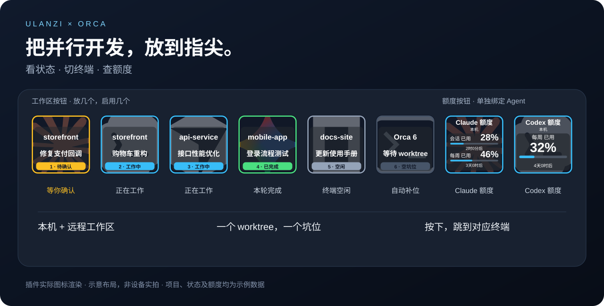
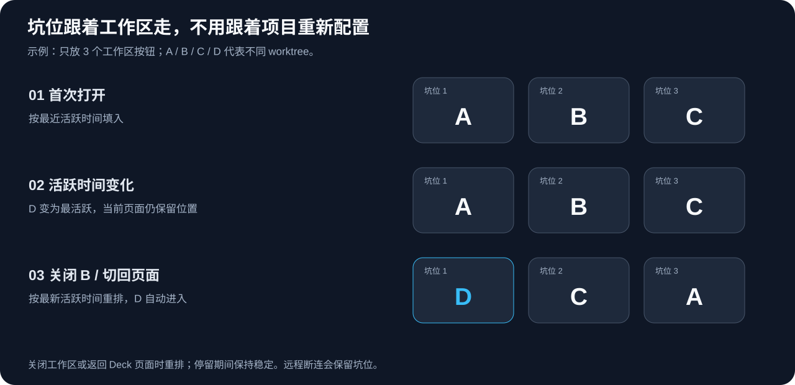

<div align="center">

# Ulanzi Orca Plugin

**把并行开发，放到指尖。**

给 [Orca](https://github.com/stablyai/orca) 配一个 Ulanzi 控制面板：看 Agent 状态、切换 worktree 终端、查看额度。

[](#快速上手)
[](#快速上手)
[](#开发与验证)



<sub>使用插件实际图标渲染器生成。示意布局，非设备实拍；项目、状态及额度均为示例数据。</sub>

</div>

## 你专注开发，按钮跟上变化

同时开几个项目、每个项目再开几个 worktree，切终端之前还得先找：哪个 Agent 在等确认？哪个任务刚完成？另一个 Mac 上的工作区在哪？

这个插件把它们放到 Deck 上。**只需拖出几个工作区按钮，之后不用为每个新项目重新绑定。**

| 你想做的事 | 按钮会怎么做 |
| --- | --- |
| 看谁需要处理 | Agent 图标作背景，叠加项目名、任务显示名称和状态 |
| 打开对应会话 | 按下工作区按钮，跳到对应 Orca 终端 |
| 管理不断变化的项目 | 按实际按钮数量分配 worktree，空位自动补入 |
| 同时用本机和远端 | 自动发现 Orca 中已配置的远程环境，统一展示 |
| 查看 Claude / Codex 等额度 | 单独拖一个额度按钮，选择 Agent 类型，显示已用比例与重置倒计时 |

## 放在什么设备上？

下面介绍 [Ulanzi Deck 官方系列](https://www.ulanzi.com/collections/deck)中的两款设备：**D200H / D200X** 都带有屏幕按键，适合把工作区和额度铺在桌面上。

<table>
<tr>
<th width="50%">D200H · 工作区看板</th>
<th width="50%">D200X · 桌面控制台</th>
</tr>
<tr>
<td align="center"><a href="https://www.ulanzi.com/collections/deck/products/d200h-deck-dock"></a></td>
<td align="center"><a href="https://www.ulanzi.com/collections/deck/products/d200x-creative-deck"></a></td>
</tr>
<tr>
<td><b>13 个可自定义按键 + 1 个信息窗口</b>，集成七合一扩展坞。适合将常用工作区集中摆在一个页面上。<br><br><a href="https://www.ulanzi.com/collections/deck/products/d200h-deck-dock">官方产品介绍 →</a></td>
<td><b>14 个 LCD 按键 + 3 个可按压旋钮</b>，集成八合一扩展坞。适合工作区、Agent 额度和其他 Studio 动作共用一个桌面控制台。<br><br><a href="https://www.ulanzi.com/collections/deck/products/d200x-creative-deck">官方产品介绍 →</a></td>
</tr>
</table>

**可以这样摆：**

| 设备 | 一页布局示例 | 适合的用法 |
| --- | --- | --- |
| D200H | 8 个工作区 + 2 个额度 + 3 个其他 Studio 动作 | 留出常用快捷键，同时看住几个并行任务 |
| D200X | 10 个工作区 + 2 个额度 + 2 个其他 Studio 动作 | 同屏查看更多 worktree；旋钮交给其他 Studio 动作 |

<sub>产品图片与硬件信息来自上述 Ulanzi 官方产品页（2026-10-21 查阅）；图片保留官方链接，版权归原权利人。布局为本项目的使用建议，不代表这些型号均已完成真机兼容测试。当前插件面向 macOS，具体设备与 Studio 版本的兼容性需实际验证。</sub>

## 三个使用场景

### ① 同一个项目，几个 Agent 并行推进

你为 `storefront` 开了两个 worktree：Claude 修支付回调，Codex 重构购物车。

两个 worktree 会各占一个坑位，即使项目名称相同，也能通过任务显示名称区分。Claude 等待确认时，按钮变为黄色「待确认」；按下就打开对应终端。Codex 继续工作，不需要重新设置按钮。

### ② 远端跑任务，本机接手处理

你的另一台 Mac 已经配对到 Orca，正在跑接口测试。本机工作区和远程工作区会出现在同一组按钮里，无需逐个选择环境。

按下远程工作区按钮，会让**本机 Orca**显示那个远程终端。远端暂时断连时保留坑位并显示「未知」，恢复后继续更新。

### ③ 一眼看状态，也一眼看额度

放 6 个工作区按钮，再放 2 个额度按钮，分别绑定 Claude 和 Codex。

工作区自动变化，额度按钮始终跟随绑定的 Agent 类型。额度**优先显示本机**；本机没有可用额度数据时才回退到远程，并显示来源环境。额度按钮不占工作区坑位。

> 上面是使用示例。额度显示的是 Orca 已有的快照，不是插件自行统计的消耗；缺失窗口不会补成 0%。

## 坑位怎么分配？



- **放几个按钮，就启用几个坑位。** 按设备上从左到右、从上到下编号，一个 worktree 对应一个坑位。
- **首次打开、关闭工作区、切回 Deck 页面时**，按最后活跃时间从近到远排列。
- **停留在页面期间**，仅活跃时间变化不会打乱位置。
- 工作区多于按钮时，配置页会显示等待数量；远程暂时断连不视为关闭。

## 快速上手

需要 macOS、Ulanzi Studio、正在运行的 Orca，以及 [mise](https://mise.jdx.dev/getting-started.html)。当前已验证的组合为 Studio 3.4.4 / Orca 1.4.232；其他版本的兼容性需实际验证。

```sh
git clone https://github.com/cleverleo/ulanzi-orca-plugin.git
cd ulanzi-orca-plugin

mise trust
mise install
mise run setup
mise run install
```

`setup` 会准备固定版本 SDK、子模块和 npm 依赖；`install` 会构建并安装插件。如果 Studio 里没有出现新动作，重启 Studio。

然后只做两件事：

1. 拖出任意数量的 **「Orca 工作区」** 按钮。无需选择项目、环境或编号。
2. 需要额度时，拖出 **「Agent 额度」** 按钮，在设置中选择 Agent 类型。

已有安装需要升级时运行 `mise run update`，会先备份旧插件。构建压缩包用 `mise run package`；完整产物位于 `dist/OrcaProjects.zip`。目前安装入口是源码构建。

## 状态速查

| 按钮状态 | 含义 |
| --- | --- |
| 🟡 待确认 | Agent 正在等待输入、确认或解除阻塞 |
| 🔵 工作中 | Agent 正在执行任务 |
| 🟢 已完成 | 当前一轮完成，整个项目可能仍未完成 |
| ⚪ 空闲 | Agent 空闲 |
| 空坑位 | 这个位置还没有运行中的 worktree |
| 🟣 未知 | 环境不可达、查询失败或无法确定状态 |

多个 Agent 共用同一个 worktree 时，只占一个坑位，优先显示等待确认、异常或工作中的 Agent。图标支持 Claude、Codex、Cursor、Gemini、OpenCode、Grok、Antigravity；其他类型使用终端图标。

## 开发与验证

项目使用 **mise + Node.js 20.18.0**，SDK 和 npm 依赖均固定版本。新 worktree 执行 `mise install`、`mise run setup` 即可独立开发。

```sh
mise run check        # 状态、坑位、额度与适配器测试
mise run integration  # 模拟 Studio 的中英文协议与交互测试
mise run build        # 构建独立插件目录
mise run probe        # 检查全部环境中的工作区元信息
mise run quota-probe  # 检查脱敏后的额度数据
```

[开发、安装细节与接口说明 →](docs/development.md)

## 几个边界

- 工作区每 2.5 秒尝试同步；额度每 30 秒读取 Orca 快照，也可按下按钮重新读取。插件不强制向供应商刷新额度。
- 工作区使用 Orca CLI；远程跳转和额度使用安装包内的版本匹配运行时接口，Orca 更新后可能需要适配。
- 点击工作区只导航到终端，不发送输入或创建会话。额度适配器只输出额度指标，不输出账号详情、令牌或凭据。
- 支持简体中文和英文，跟随 Studio 语言，其他语言回退英文。项目和任务名称保留原文。

## 致谢

基于 [Ulanzi 官方插件 SDK](https://github.com/UlanziTechnology/UlanziDeckPlugin-SDK) 和 [Orca](https://github.com/stablyai/orca)。Agent 图标来自 Lobe Icons。

第三方 SDK 使用 Apache-2.0，ws 和 Lobe Icons 使用 MIT；构建保留对应许可声明。

普通 Terminal / Shell 工作区不占坑位；只展示检测到 Agent 的工作区，Agent 空闲或本轮完成时仍保留。
